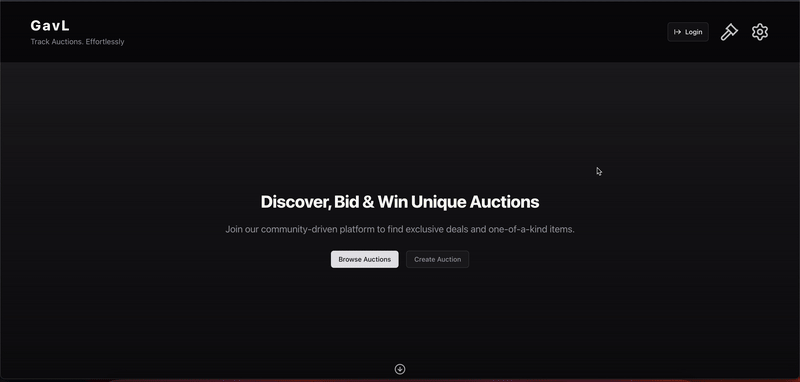
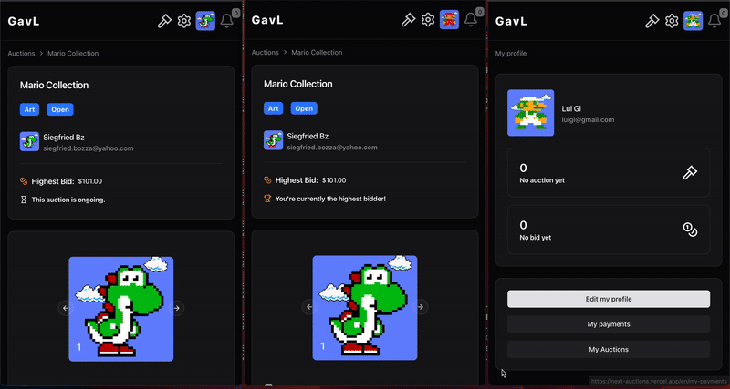
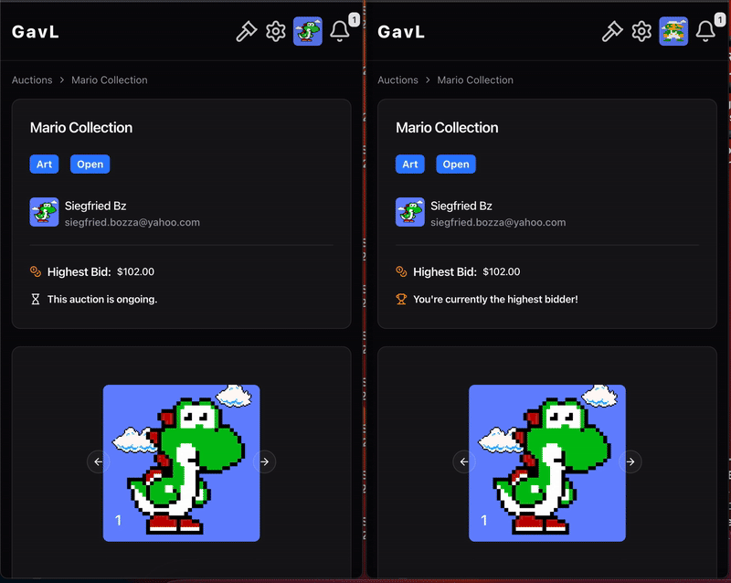
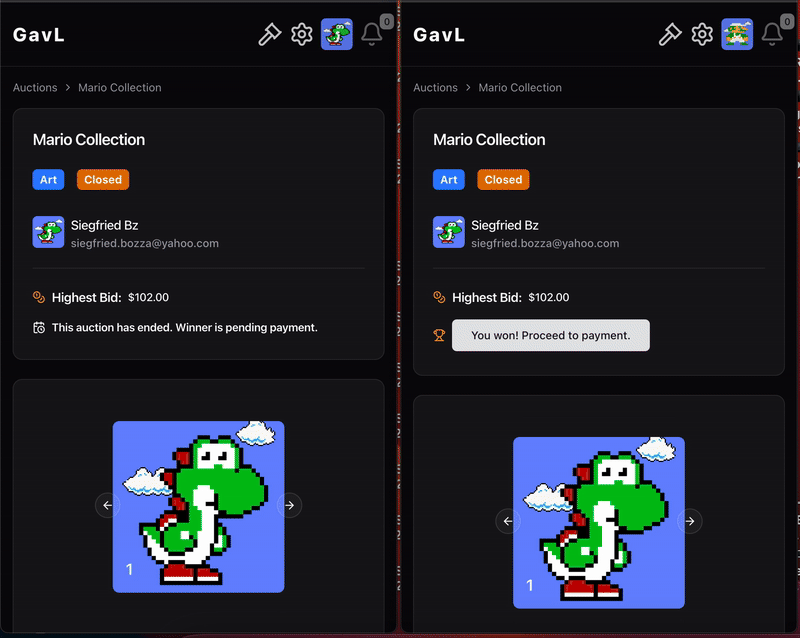
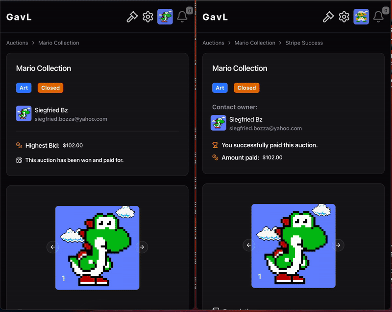
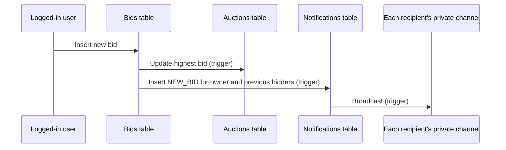
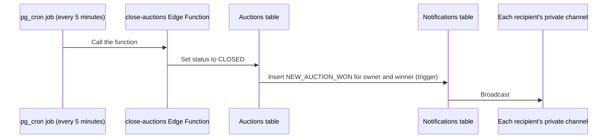
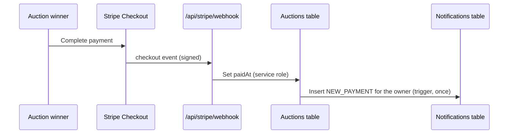

[](https://next-auctions.vercel.app/en)

# GavL – Next Auctions

An auction platform built with **Next.js**, **TypeScript**, **Supabase** and **Stripe** (test mode): create auctions, bid, get notified in real time when you are outbid or win, and pay the winning bid through Stripe Checkout. The UI is in English, French and German.

I built it from September to November 2025 to practise full-stack work around a database that does most of the work: highest-bid tracking and notifications run in Postgres triggers, access rules in Row Level Security, and the app and the Edge Function stay thin. It is a personal project, not a production marketplace: bid and payment rules are not all enforced on the server yet (see [Known bugs](#known-bugs)).

---

## Quick start

1. Open the [live demo](https://next-auctions.vercel.app/en).
2. Sign up (email and password, no confirmation email), create an auction or bid on an open one.
3. To pay for an auction you won, use Stripe's test card `4242 4242 4242 4242`.

---

## Demo

### Desktop



### Mobile

**Login**


**Create auctions**


**Bidding, with live notifications (2 users)**


**Bidding, with live notifications (3 users)**



**Auction won notifications**



**Stripe payment**



**Payments dashboard**



---

## Tech stack

| Area | Technologies |
|------|--------------|
| Frontend | React, Next.js, TypeScript, shadcn/ui, React Hook Form, Zod, TanStack Table, Uppy (image uploads), React Suspense with skeleton loaders |
| URL state | nuqs: filters, sorting and pagination in the URL, applied on the server |
| Internationalization | Lingui: English, French and German, plus a pseudo-locale for testing |
| Backend and database | Supabase: Postgres with triggers and Row Level Security, Realtime (private broadcast channels), an Edge Function to close auctions, called every 5 minutes by pg_cron |
| Payments | Stripe Checkout and a signature-verified webhook |
| Quality | Jest, Biome, Husky; CI runs lint, build and test coverage |

## Architecture

The code follows a ports-and-adapters layout, so the business code does not depend on Supabase directly:

- **Domains:** types and Zod schemas for each entity (Auction, Bid, Notification, Payment, User).
- **Ports:** repository interfaces for all data access.
- **Services:** business logic and workflows, written against the ports.
- **Instances:** services wired to the Supabase repositories.
- **Infra (Supabase):** repository implementations that map database rows to domain models.

Much of the behaviour lives in the database:

- **Triggers** (`SECURITY DEFINER`) keep each auction's highest bid and bidder up to date and insert `NEW_BID`, `NEW_AUCTION_WON` and `NEW_PAYMENT` notifications.
- **Row Level Security:** owners cannot edit or delete an auction that has bids, but can close one with none; users cannot delete their account while they have bids on open auctions; each notification is visible only to its recipient. A bid amount is unique per auction.
- **Realtime:** each user listens on a private broadcast channel, `user:<id>:notifications`. Only notifications are real time; other viewers of an auction do not see its price change live.
- **Schemas:** declarative Supabase schemas, with migrations generated by diff.

## Key workflows

### 1. Authentication

Supabase email and password sign-up and login (no email confirmation, for simplicity).

### 2. Filter, sort and paginate auctions on the server

Filters, sorting and pagination live in the URL (nuqs). The server reads `searchParams` and calls the `auctions().listing` service, which delegates to `SupabaseAuctionRepository`, so a URL can be shared and gives the same results.

### 3. Create and manage auctions

Authenticated users create draft auctions, add images, edit them and open them for bidding. Owners cannot edit auctions that already have bids or are closed.

### 4. Bidding and notifications

When a bid is inserted, a trigger updates the auction's highest bid and bidder and inserts a `NEW_BID` notification for the owner and previous bidders, which reaches them on their private Realtime channel.



### 5. Closing auctions (scheduled Edge Function)

A pg_cron job calls the `close-auctions` Edge Function every 5 minutes, and the function sets every auction past its `endAt` to `CLOSED`. If the auction had bids, a trigger notifies the owner and the winner (`NEW_AUCTION_WON`). The job is a migration that reads the project URL and key from Vault: see [Run locally](#run-locally).



### 6. Stripe Checkout and webhook

The winner pays through Stripe Checkout. `/api/stripe/webhook` reads the raw body, verifies Stripe's signature (`constructEvent`, `400` on a bad signature), then sets the auction's `paidAt` with a service-role Supabase client. A trigger that fires only when `paidAt` goes from empty to set sends `NEW_PAYMENT` to the owner once. The `/api` routes are excluded from the i18n middleware.



### 7. Stats and charts

Dashboards show each user's payments made and received, plus global totals and charts, through the same service and repository layer.

---

## Known bugs

- **Bid integrity.** The server does not check that a bid beats the current highest (only the form does). Row Level Security lets bidders edit or delete their own bids while an auction is open, and owners can bid on their own auctions. Bids are accepted between `end_at` and the next scheduled close, up to 5 minutes later. `update_auction_highest_bid` reads `MAX` without a lock, so two near-simultaneous bids can store a stale highest bid. Fix: a `place_bid` function that locks the auction row and checks the amount and the deadline, and no update or delete on bids.
- **Payment checks are UI-only.** `createCheckoutSession` does not check on the server that the caller is the winner, or that the auction is closed and unpaid; the webhook trusts `metadata.auctionId`.
- **Webhook retries** are not deduplicated by `event.id`; a retry rewrites `paidAt`, but the payment notification still fires once.

## Known limitations

- **Tests cover services and mappers only.** 66 Jest tests in 13 files test the services against mocked repositories, the mappers and the wiring. Nothing tests the triggers, the RLS policies, the webhook, the Edge Function or the server actions.
- `updateAuctionPaidAt` is a server action with no auth check of its own; today only the webhook route uses it.

---

## Run locally

### 1. Clone and install

```bash
git clone https://github.com/SiegfriedBz/Next-Auctions.git
cd Next-Auctions
pnpm install
```

### 2. Environment variables

Create `.env.local` from `.env.example`:

```bash
# Application
NEXT_PUBLIC_APP_URL= # Base URL of your app (e.g., http://localhost:3000)

# Supabase
DATABASE_URL= # Full database connection URL (used by Supabase CLI / server)
NEXT_PUBLIC_SUPABASE_URL= # Supabase project URL for client-side access
NEXT_PUBLIC_SUPABASE_PUBLISHABLE_KEY= # Public anon key for client-side API calls
SUPABASE_SERVICE_ROLE_KEY= # Secret service role key for server-side actions (keep private!)

# Stripe
NEXT_PUBLIC_STRIPE_PUBLISHABLE_KEY= # Public key for Stripe JS (client-side)
STRIPE_SECRET_KEY= # Secret key for server-side Stripe actions (keep private!)
STRIPE_WEBHOOK_SECRET= # Secret used to verify Stripe webhooks (keep private!)

# Footer (optional)
ADMIN_LINK= # URL for the footer credit link (defaults to https://github.com/SiegfriedBz if unset)
```

### 3. Vault secrets for the close-auctions schedule

In your Supabase project's SQL editor, store the project URL and the `service_role` key (Project Settings → API keys):

```sql
select vault.create_secret('https://<project-ref>.supabase.co', 'project_url');
select vault.create_secret('<service_role key>', 'service_role_key');
```

### 4. Database and Edge Function

```bash
supabase db push
supabase functions deploy close-auctions
```

The migrations create the notifications broadcast trigger and the `realtime.messages` policy that lets each user listen only on their own `user:<id>:notifications` channel. They also schedule the pg_cron job `Cron => close auction`, which posts to `/functions/v1/close-auctions` every 5 minutes with the `service_role` key as `Authorization: Bearer`. The function has `verify_jwt = true`, so the call needs a JWT. If the two secrets are missing, that migration skips the job and logs a warning; create them, then run the `DO` block of `supabase/migrations/20261030082733_schedule_close_auctions.sql` by hand. The live project runs the same job, created in the dashboard (Integrations → Cron) with the key written into it.

### 5. Start

```bash
pnpm dev
```

## Tests

```bash
pnpm test
```

Unit tests (Jest) for the services, with mocked repositories, and for the mappers. CI runs `pnpm lint:check`, `pnpm build` and `pnpm test:coverage` on GitHub Actions.

---

## License

MIT.

## Author

Built solo by **Siegfried Bozza**, Full-Stack Web3 Engineer.

[LinkedIn](https://www.linkedin.com/in/siegfriedbozza/) · [GitHub](https://github.com/SiegfriedBz)
